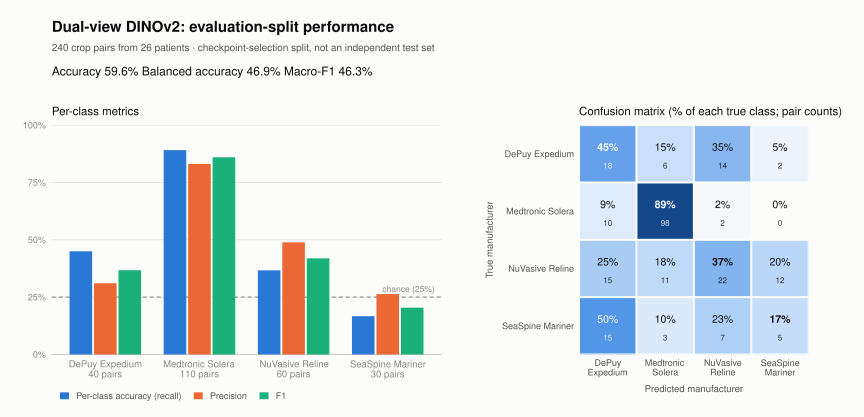

# Orthopedic screw classification with dual-view DINOv2

This repository hands over a trained **dual-view DINOv2 manufacturer classifier** and code to train, evaluate, and use it. It takes an AP screw crop and a lateral screw crop from the same patient. The images, masks, and labels are published separately as the Hugging Face dataset [`austin-carnahan/orthopedic-screw-images`](https://huggingface.co/datasets/austin-carnahan/orthopedic-screw-images) (see [Data](#data)); no images, masks, metadata rows, or patient identifiers are committed here.

This model is the one served by the [OrthoScrew ID Hugging Face Space](https://huggingface.co/spaces/austin-carnahan/orthopedic-screw-identification), which backs the [OrthoScrew ID web app](https://github.com/SLUVisLab/iris-orthopedic). Deployment code (Space, similarity index, deploy scripts) lives in that repository's `ml/` folder.

## Results

The supplied checkpoint achieves **59.6% crop-pair accuracy (143/240)**, **46.9% balanced accuracy**, and **46.3% macro-F1** on the 26-patient evaluation split. This is a diagnostic on the reconstructed checkpoint-selection split, not an independent final test. See [the evaluation report](reports/checkpoint_evaluation.json).

<picture>
  <source media="(prefers-color-scheme: dark)" srcset="reports/checkpoint_evaluation_dark.svg">
  
</picture>

| Manufacturer | Eval pairs | Per-class accuracy (recall) | Precision | F1 |
| --- | ---: | ---: | ---: | ---: |
| DePuy Expedium (Synthes) | 40 | 45.0% | 31.0% | 36.7% |
| Medtronic Solera | 110 | 89.1% | 83.1% | 86.0% |
| NuVasive Reline | 60 | 36.7% | 48.9% | 41.9% |
| SeaSpine Mariner | 30 | 16.7% | 26.3% | 20.4% |
| **Macro average** | 240 | **46.9%** | **47.3%** | **46.3%** |

How to read this:

- Overall accuracy is driven by Medtronic, which is 110 of the 240 evaluation pairs. Balanced accuracy and macro-F1 weight every manufacturer equally and are the better summary.
- SeaSpine is the weakest class: half of its pairs are predicted as DePuy, and its recall is below chance (25%).
- Every class rests on few patients (roughly 3 to 11 evaluation patients each), and the 10 pairs per patient are correlated, so per-class numbers can move by tens of points with a different split.
- For context, the previously deployed dual-view ResNet18, scored on the same 240 crop pairs, reached 49.6% accuracy, 48.4% balanced accuracy, and 49.4% macro-F1. DINOv2 is ahead on overall accuracy; on the class-balanced metrics the two are within a few points, with ResNet18 slightly ahead. They fail differently: ResNet18 never predicted NuVasive and labelled about half of all pairs SeaSpine, while DINOv2 predicts every class. See [`legacy/resnet18/`](legacy/resnet18/).

## Methodology

**Task.** Given two X-rays of the same patient, one anteroposterior (AP) and one lateral, predict which of four manufacturers made the patient's pedicle screws. Each patient has one manufacturer label, so the label applies to every screw in both views.

**Data.** The [Hugging Face dataset](#data) has 526 X-ray images from 217 patients, with a binary screw mask for each image. Patients with no manufacturer label, and the Stryker Everest and Orthofix Firebird groups, are excluded. Then any manufacturer with fewer than 10 patients is dropped. What remains is 319 images from 130 patients in four classes: Medtronic Solera (71 patients), NuVasive Reline (28), DePuy Expedium (19), and SeaSpine Mariner (12). Only AP and lateral images are used. The classes are imbalanced, and the dataset is small.

**Patient split.** Patients, not images, are split 80/20 into 104 training and 26 evaluation patients (`random_state=42`). All of a patient's images therefore land on one side of the split. The split is meant to be stratified by class, but the historical code misaligns the stratification labels. The evaluation patients are also used to pick the checkpoint, so there is no separate held-out test set. [Reproduction limits](#reproduction-limits) covers both points.

**From X-ray to model input.** Whole radiographs are not fed to the model. For each sample, the loader:

1. picks a random AP image and a random lateral image from the same patient;
2. finds the screws in each image's mask (connected regions over 100 px in area) and picks one screw at random in each view, chosen independently, so the AP and lateral screws need not be the same physical screw;
3. crops a square around that screw, twice its larger bounding-box side, with a ±5 px jitter of the center and edge-replicated padding at image borders;
4. resizes the crop to 224×224 (training uses a random 224 crop of a 256 resize plus random horizontal and vertical flips), converts it to 3-channel grayscale, and applies ImageNet normalization.

Because the image, the screw, and the jitter are all drawn at random, each epoch shows the model different crops of the same patients.

**Model.** One DINOv2 ViT-S/14 backbone (about 22M parameters), pretrained by Meta with self-supervision on natural images, encodes both crops. The backbone is shared between the views and kept **frozen**; it is used as a fixed feature extractor. Its 384-dimension [CLS] embeddings for the AP and lateral crops are concatenated into one 768-dimension vector. A small head (`Linear 768→512 → ReLU → Dropout 0.5 → Linear 512→4`) maps that vector to four manufacturer scores. The head's roughly 400k parameters are the only part that is trained. The same 768-dimension vector is what the deployed Space uses to retrieve similar cases.

**Training.** Each epoch draws one AP/lateral crop pair per training patient (104 pairs). Patients are sampled with replacement, with weights inversely proportional to their class's patient count, so the four manufacturers appear about equally often despite the imbalance. The head is trained with cross-entropy and Adam (learning rate 1e-4, weight decay 1e-4), batch size 16, for 50 epochs. `train.py` saves both the best-scoring checkpoint on the evaluation patients and the last one. The supplied checkpoint corresponds to the final epoch of the original run. The full recipe is in [Train a new model](#train-a-new-model).

**Evaluation.** Each of the 26 evaluation patients contributes 10 random crop pairs, drawn with the deterministic resize-only transform and a fixed seed. That gives 260 pairs, of which 240 are valid; two patients have no usable AP/lateral pair. Each pair is classified independently. The reported metrics are crop-pair accuracy, balanced accuracy (the mean of per-class recall), per-class precision and F1, macro-F1, and the confusion matrix. Pairs from the same patient are correlated, so the effective sample size is closer to 26 patients than to 240 pairs.

## Get the code and weights

```bash
gh repo clone SLUVisLab/ortho_screw_dinov2
cd ortho_screw_dinov2

python -m venv .venv
source .venv/bin/activate
pip install -r requirements.txt

gh release download handoff-v1 --repo SLUVisLab/ortho_screw_dinov2 \
  --pattern '*.pth' --dir weights
python verify_weights.py
```

Access to this private repository is required. Alternatively, download the two weight files from the [release page](https://github.com/SLUVisLab/ortho_screw_dinov2/releases/tag/handoff-v1) and place them in `weights/`.

The same two files are also published in the Hugging Face model repository [`austin-carnahan/orthopedic-screws-model`](https://huggingface.co/austin-carnahan/orthopedic-screws-model), which needs no GitHub access:

```bash
hf download austin-carnahan/orthopedic-screws-model \
  dinov2_dual_view.pth dinov2_vits14_pretrain.pth --local-dir weights
python verify_weights.py
```

The release contains:

| File | Purpose |
| --- | --- |
| `dinov2_dual_view.pth` | The trained four-class dual-view model |
| `dinov2_vits14_pretrain.pth` | Pretrained DINOv2 backbone initialization for a new training run |

Checksums and file sizes are in [weights_manifest.json](weights_manifest.json). The architecture source is vendored, so loading these files does not fetch changing code or weights from Torch Hub.

Verification used Python 3.10.17, PyTorch 2.9.1, torchvision 0.24.1, and Apple MPS. For a CUDA server, install the corresponding CUDA-enabled PyTorch build. `--device auto` selects CUDA, then MPS, then CPU. Missing optional xFormers warnings are harmless for this workflow.

## Data

### Download from Hugging Face (recommended)

The dataset is public at [`austin-carnahan/orthopedic-screw-images`](https://huggingface.co/datasets/austin-carnahan/orthopedic-screw-images) (about 630 MB). The `hf` command comes with `huggingface_hub`, which is in `requirements.txt`:

```bash
hf download austin-carnahan/orthopedic-screw-images --repo-type dataset \
  --revision d2af488859875b46bf5abf88f905b26069813597 --local-dir data/hf
```

Then pass the dataset's `data/` folder (the one containing `metadata_summary.csv`) to every script:

```bash
python evaluate.py --data-dir data/hf/data ...
python train.py --data-dir data/hf/data ...
```

`data/` is gitignored. The `--revision` pins the exact snapshot the reported results were produced from; drop it to get the latest version. The dataset also contains `metadata.csv` (Hugging Face image-folder format), per-patient `binary_masks/`, and de-identified DICOM header `.json` files, which these scripts do not use.

### Use a local copy

Any local directory with the same layout works; pass the directory containing `metadata_summary.csv` as `--data-dir`. The CSV must contain:

| Column | Meaning |
| --- | --- |
| `manufacturer` | Manufacturer label using the class names below |
| `patient_number` | Patient grouping identifier; all rows for one patient must share a label |
| `view_position` | `AP` or `LATERAL` |
| `relative_file_path` | Image path relative to the data directory |

Images are arranged under `manufacturer/patient/images/`. Their masks are under the matching `manufacturer/patient/masks/` directory. A mask has the same filename with `_mask` inserted before the extension. Preserve the CSV row order when reproducing the historical split.

The loader samples AP and lateral images from the same patient, finds screw mask contours larger than 100 pixels in area, and independently selects one screw in each view. It extracts a context crop twice the largest bounding-box dimension, with a small center jitter and replicated border padding. It does not establish anatomical correspondence between individual screws across views. Patients without a valid pair are skipped and counted in evaluation.

The `metadata_sha256` recorded in the original handoff verification differs from the Hugging Face copy of `metadata_summary.csv`, but evaluating on the Hugging Face copy reproduces the same split, the same 240 valid pairs, and the identical confusion matrix. [The current report](reports/checkpoint_evaluation.json) records the Hugging Face file's hash.

## Evaluate the supplied model

```bash
python evaluate.py --data-dir data/hf/data \
  --checkpoint weights/dinov2_dual_view.pth \
  --device auto --seed 42 --workers 4 --batch-size 32 \
  --output runs/checkpoint_evaluation.json
```

This reproduces the reported protocol: a patient-disjoint 80/20 split with `random_state=42`, 10 sampled pairs per evaluation patient, and the supplied checkpoint. The data used for verification had 104 training patients and 26 evaluation patients. Of 260 nominal evaluation pairs, 240 were valid and 20 were skipped.

The JSON includes overall accuracy, balanced accuracy, macro precision and macro-F1, per-class recall (per-class accuracy), precision, F1, and support, the confusion matrix, skipped counts, sampling settings, and SHA256 hashes of the model and metadata. Crop sampling is stochastic; keep the seed, worker count, software versions, metadata ordering, and files fixed for repeatability. Hardware differences can also change numerical results.

To plot a report (per-class accuracy, precision, and F1 bars plus a row-normalized confusion matrix), run:

```bash
python plot_evaluation.py runs/checkpoint_evaluation.json
```

This writes `runs/checkpoint_evaluation.svg` and a dark-theme `runs/checkpoint_evaluation_dark.svg`; `--output` picks another path or a `.png`. Precision and F1 are recomputed from the confusion matrix, so reports from the earlier evaluator also work. The figure in [Results](#results) was made this way from [the committed report](reports/checkpoint_evaluation.json).

For a newly trained checkpoint, use its saved patient split:

```bash
python evaluate.py --data-dir data/hf/data \
  --checkpoint runs/new_training/best_dual_view.pth \
  --split-config runs/new_training/run_config.json \
  --output runs/new_training/reevaluation.json
```

The evaluator verifies that the split configuration belongs to the checkpoint. This is another evaluation of the selection set, not a new final test.

## Train a new model

```bash
python train.py --data-dir data/hf/data \
  --output-dir runs/new_training \
  --epochs 50 --batch-size 16 --workers 2 --device auto
```

The output directory must not exist. The backbone is frozen and only the small classifier head is trained, so memory use is modest; `--batch-size` is the setting to lower if a GPU runs out of memory, and `--epochs` shortens a run. Training starts a new classifier head over the frozen pretrained backbone; it does not resume the supplied classifier. The recipe recovered from the original local source is:

| Setting | Value |
| --- | --- |
| Backbone | Shared pretrained DINOv2 ViT-S/14, frozen |
| View features | 384 dimensions each, concatenated to 768 |
| Classifier | Linear 768→512, ReLU, dropout 0.5, Linear 512→4 |
| Loss | Cross entropy |
| Optimizer | Adam on the classifier head, learning rate `1e-4`, weight decay `1e-4` |
| Training | 50 epochs; batch size 16; inverse-class-frequency patient sampling with replacement |
| Training transform | Resize to 256×256; random 224×224 crop; horizontal and vertical flips |
| Evaluation transform | Resize to 224×224 |
| Both transforms | Three-channel grayscale; ImageNet normalization |

The model's class indices are fixed:

| Index | Manufacturer |
| --- | --- |
| 0 | Depuy expedium (Synthes) |
| 1 | medtronic solera |
| 2 | nuvasive reline |
| 3 | seaspine mariner |

Filtering excludes missing manufacturer labels, `Styker everest (K2M)` and `orthofix firebird`, then drops manufacturers with fewer than 10 patients. The transferred metadata used for verification retained the four classes above.

Training writes `best_dual_view.pth`, `last_dual_view.pth`, `metrics.json`, and `run_config.json`. The best checkpoint is selected by evaluation accuracy. Checkpoints include the full model state, class order, epoch, metrics, and configuration. The configuration includes patient split IDs and should remain with the data, outside Git; `runs/` is ignored.

### Reproduction limits

The supplied checkpoint was recovered from the local `dinov2_dual_view.pth`, with file timestamps of January 26, 2026. The corresponding source saves the final epoch, and the saved backbone exactly matches the pretrained backbone included in the release. A complete original training manifest and random-number state were not retained. The recipe is supported by preserved source, and the released weights were verified directly; an identical retrained checkpoint or score is not guaranteed.

The original split code passes sorted patient labels against patients in first-seen order. The default `--split-mode historical` retains this behavior for comparison. `--split-mode aligned` corrects label alignment and creates a different split. For new generalization claims, establish separate patient-disjoint training, validation, and final test sets rather than treating the checkpoint-selection set as a final test. This small dataset's evaluation is also class imbalanced; use the per-class and balanced metrics alongside overall accuracy.

## Predict from prepared crops

```bash
python predict.py --ap /path/to/ap_context_crop.png \
  --lateral /path/to/lateral_context_crop.png --device cpu
```

Inputs should be screw-centered context crops, approximately twice the screw's largest bounding-box dimension. The script returns four softmax scores. It uses the released checkpoint by default; `--checkpoint` can select another compatible checkpoint. Both views are required, and loading fails explicitly for missing or incompatible weights.

## Verify the implementation

```bash
python -m unittest discover -s tests -v
```

The unit tests need no data or weights. They cover rejection of non-dual-view checkpoints, all-invalid batches, the metric calculations (accuracy, balanced accuracy, precision, F1, and a never-predicted class), and rejection of overlapping saved splits.

Broader checks were run once for the original handoff and are summarized in [`reports/verification.json`](reports/verification.json): strict loading and evaluation of the released checkpoint on real data, a one-epoch training run, reloading a trained checkpoint with its saved split, and confirming the backbone is unchanged after training. They are not automated tests. To repeat the most important one, download the data and weights and run the evaluation command above; it should report 143 of 240 pairs correct.

No sample images or patient-level records are committed.

Core files: `model.py` defines the model; `dataset.py` makes paired crops; `train.py`, `evaluate.py`, `plot_evaluation.py`, and `predict.py` are the executable entry points. [`legacy/resnet18/`](legacy/resnet18/) archives the previously deployed ResNet18 model for comparison. [THIRD_PARTY.md](THIRD_PARTY.md) documents the vendored DINOv2 source.
